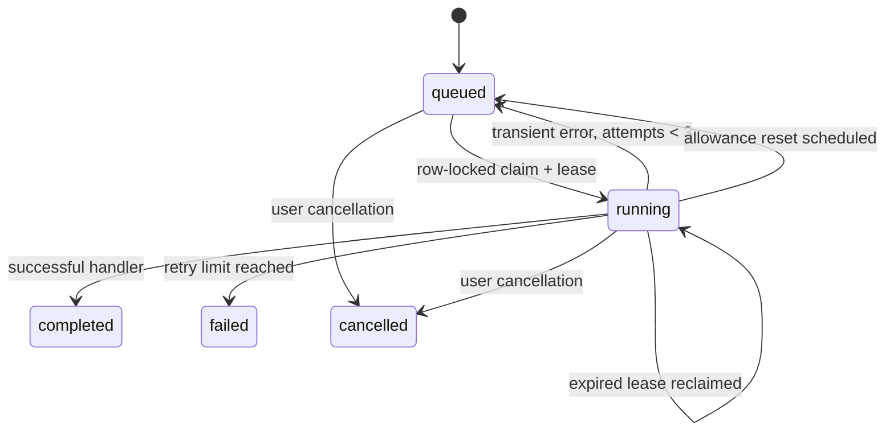

# Architecture

EasySolve uses TypeScript, Next.js App Router, React, PostgreSQL, Prisma 7 with the official PostgreSQL adapter, and the OpenAI SDK with separate AgentRouter Chat Completions and direct OpenAI Responses adapters. Styling is a shared CSS component system; Lucide supplies icons. Instrument Sans, Figtree, and IBM Plex Mono load through Google Fonts with system fallbacks. There are no copied product assets or private APIs.

## Boundaries

- `app/`: document, routes, security headers, global theme and component tokens.
- `components/workspace.tsx`: responsive application shell, navigation, command menu, authenticated bootstrap, overview.
- `components/pages/`: contributor, maintainer, run, review, and settings screens.
- `lib/api.ts`: method restrictions, CSRF, authentication, rate limiting, request size checking, error normalization.
- `lib/routes/`: account/auth, bootstrap, repository, run, contribution, and review endpoint handlers.
- `lib/security.ts`: hashed sessions, AES-GCM token encryption, origin checks, public errors, patch fingerprints.
- `lib/github.ts`: authenticated server-only GitHub requests, pagination, issue/repository synchronization, PR review-state derivation.
- `lib/providers/openai.ts`: streamed OpenAI Responses adapter, final receipt validation, and redacted provider errors.
- `lib/ai.ts`: provider integration, serialized per-user allowance checks, actual usage persistence, configurable model.
- `lib/chat.ts`, `lib/chat-tools.ts`: persistent conversations and function-tool dispatch. Read results use owned records. Run/sync actions are previews until confirmed. Assignment tools validate proposals but never apply assignments automatically.
- `lib/assignments.ts`, `lib/wave.ts`: assignment validation and partial results; grounded issue matching and application drafting.
- `lib/queue.ts`: transactional issue claims, batching, entitlements, idempotent enqueue, leased claims.
- `worker/`: separate long-running orchestrator and bounded coding agent. Only the worker invokes Docker.
- `sandbox/`: trusted minimal execution image and request runner. No provider credentials or host source mounts.
- `prisma/`: schema, checked-in migrations, explicit development account seed.

## Data model and ownership

Each registered user owns a private workspace. Ordinary workspace API queries scope records to the authenticated user ID, including integration identities, conversations, jobs, runs, proposals, and artifacts. Workers load provider identities with both the job’s user and identity IDs. The frontend never supplies the user ID used for authorization. The implementation does not provide shared organization workspaces, organization roles, invitations, or cross-user usage leaderboards.

Site administration is a separate database `ADMIN` role with default `USER`. The `/admin` Server Component and every `/api/admin/*` handler check the current database-backed session, role and suspension state. Its cross-account projections omit secrets. Administrative account/job/plan changes recheck authorization inside a serialized transaction and write an `AdminAudit` record atomically. A singleton `AdminBootstrap` marker protects the one-time server-only owner promotion command; signup never grants elevated access. Suspension revokes sessions and blocks new work, and per-account plan columns supply server-controlled usage ceilings. See [ADMIN.md](ADMIN.md).

PostgreSQL stores users, expiring hashed sessions and recovery tokens, encrypted identities, repositories and live health snapshots, issues, runs with patch artifacts, jobs, conversations, actual provider usage, assignment proposals, applications, and rate-limit windows. Database cascades clean up owned records. Tokens are encrypted before insert; only public identity projections are serialized.

Artifacts are intentionally bounded and stored in PostgreSQL. Object storage is unnecessary for the current 2 MB source budget. Increasing limits should introduce authenticated object-storage access and lifecycle rules instead of large bootstrap responses.

## Queue and recovery

Claims use `FOR UPDATE SKIP LOCKED`, plus a short global advisory lock to enforce `WORKER_CONCURRENCY` across processes. Each worker executes one job at a time. Heartbeats extend a 120-second lease every 30 seconds and include the attempt number, preventing an older attempt from finalizing a recovered job. Failed jobs retry with increasing delay, up to three attempts. Jobs waiting for usage reset remain queued. New jobs are created with unique idempotency keys in the same transaction that claims their issues.

A permanent worker process schedules assigned-issue syncs and managed-repository snapshots every 15 minutes. The browser is not the scheduler. User settings can disable autosync. Manual sync uses the same durable queue and cannot enqueue coding work.

Run states are separate from queue states: queued, running, planned, awaiting_review, published, completed, failed, cancelled. Retry preserves the run and branch. A crash restarts inspection in a fresh container; it does not resume an arbitrary half-finished shell process. Previously persisted logs and test output are evidence, not proof the restarted attempt completed.

## Execution and publication

The worker downloads a bounded GitHub tree and text blobs through server-side provider requests, excluding secrets paths, binary files, symlinks, lockfiles, and dependency trees. The container receives only selected text files. It runs as UID 10001 with no network, capabilities, privileged mode, host mounts, or injected secrets. CPU, memory, process count, writable tmpfs size, command duration, model steps, and overall execution time are bounded.

The agent can read source, replace/create text files, and execute commands. Commands run only in the container, never in the web server. Tests record actual exit codes/stdout/stderr. Dependencies are not fetched from the internet; unsupported test environments fail visibly. Plan-only mode does not create a sandbox or patch.

Approval binds to a canonical SHA-256 fingerprint of persisted patch content. Cancellation/retry and publication coordinate using a per-run advisory lock. Publication checks the stored fingerprint again, creates deterministic Git objects, validates any existing branch’s tree/parent/message, and looks up an existing PR before creating another. The commit’s fixed author date prevents new objects from being minted just because a request was retried. If the identity lacks upstream push access, the approved publication creates/uses a verified fork and opens a PR back to upstream. Fork readiness or organization policies can delay or prevent publication.

## Review safety

The queue fetches actual PR heads, reviews, check runs, combined commit statuses, and mergeability. Only reviews bound to the current head count. Drafts, merge conflicts, and failed checks block readiness. A PR with no checks is not automatically treated as passing. Merge requests include the exact reviewed SHA; GitHub remains authoritative for branch protection and allowed merge methods. The implementation uses squash merges, and reports GitHub refusals.

Bulk merge is a confirmed sequence, not an all-or-nothing GitHub transaction. Every result is reported separately. Assignment apply similarly rechecks each issue, skips already completed entries, and records partial failures.

## Security decisions

Sessions are random 256-bit secrets; only hashes are stored. Cookies are HttpOnly, SameSite=Lax and Secure in production. State-changing endpoints require the exact configured Origin. Passwords use bcrypt; reset tokens are short-lived and single-use; password changes revoke other sessions. Zod validates domain inputs. Rate windows persist in PostgreSQL. Untrusted issue/repository/model text is rendered as text, never injected HTML.

Docker isolation is a useful local boundary, not a guarantee against kernel exploits. Operate workers on dedicated hosts/VMs with a trusted Docker service. The web process does not require Docker access. Do not mount a production Docker socket into the web app. A hardened public service should use a dedicated sandbox service or microVM pool, remote secret management, centralized audit/monitoring, and independent security review.

`lib/providers/index.ts` selects exactly one server-configured provider. Both web and worker share this dispatch and usage accounting. AgentRouter requires a matching token-scoped catalog ID and never falls back to direct OpenAI. Provider verification is bound to provider, credential, base URL and model. Historical provider usage is unchanged.
